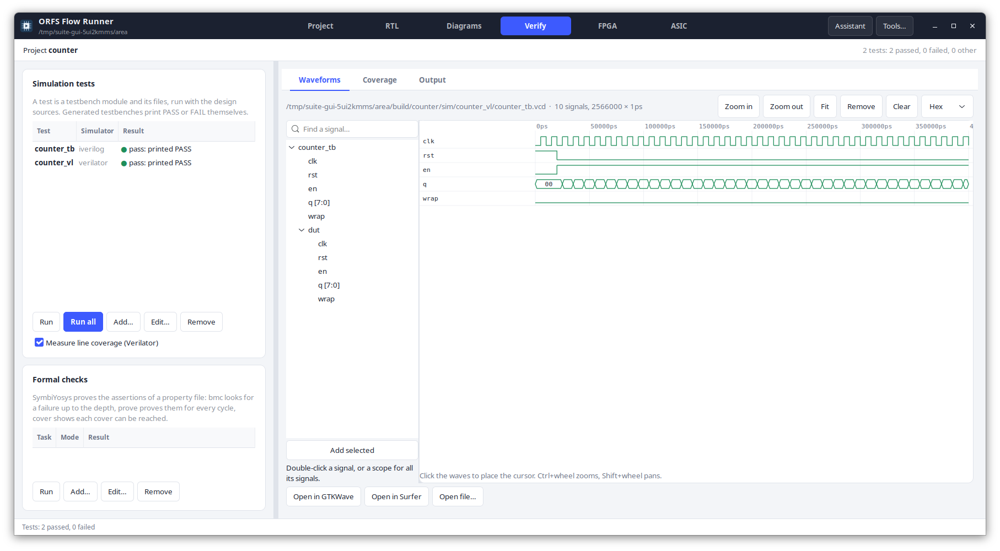

# ORFS Flow Runner as an EDA suite: RTL, verification, FPGA, diagrams, LEC and the assistant

ORFS Flow Runner covers the whole path from an empty folder to a chip or an FPGA bitstream. The header bar
switches between six sections that share one **project** (a folder of RTL); the **Assistant** button opens an AI
design assistant beside any of them.

| Section | What you do there | Tools it runs |
| --- | --- | --- |
| **Project** | Make a work area, create, clone or import projects, pick the top module, include folders, defines; git pull and commit | git |
| **RTL** | Write Verilog/SystemVerilog in an editor with syntax colors, find, undo; lint; generate testbenches and formal wrappers | Verilator, Icarus, Yosys |
| **Diagrams** | Draw architecture diagrams like draw.io, or a block diagram from the RTL; export PNG/SVG | – |
| **Verify** | Simulation tests and regressions, line coverage, waveforms, formal checks | Icarus, Verilator, SymbiYosys, GTKWave/Surfer |
| **FPGA** | Pick a board, assign pins, build, read Fmax and utilization, program the board | Yosys, nextpnr, icepack/ecppack/gowin_pack, openFPGALoader |
| **ASIC** | The OpenROAD flow from RTL to GDS with every input in pages (see [ORFS_flow_guide.md](ORFS_flow_guide.md)), and **LEC** | Yosys, OpenROAD, KLayout |

Everything is done in the app: no terminal is needed for any step below.

Contents: [Install the tools](#install-the-rtl-and-fpga-tools) · [Project](#project) · [RTL](#rtl) ·
[Diagrams](#diagrams) · [Verify](#verify) · [FPGA](#fpga) · [ASIC and LEC](#asic-and-lec) ·
[Assistant](#the-assistant) · [Walkthrough](#walkthrough-a-counter-from-an-empty-folder-to-gds-and-an-fpga) ·
[Files](#where-things-are-saved) · [Testing](#testing)

## Install the RTL and FPGA tools

Click **Tools…** in the header, tab **RTL and FPGA**. The tab lists each tool, whether it was found, and lets
you pick a different program. **Install OSS CAD Suite…** downloads the YosysHQ OSS CAD Suite (about 700 MB,
2 GB on disk) into `~/.local/share/orfs-flow-runner/oss-cad-suite`; no admin rights are needed. Tools are taken
from the suite first, then from `PATH`. Tested with suite build 2026-11-14 (Icarus 14, Verilator 5.055,
Yosys 0.71, nextpnr, SymbiYosys).

The ASIC flow keeps using the OpenROAD and Yosys chosen on the **ASIC flow** tab, so a suite install never
changes an ASIC result.

## Project

A **work area** is a folder for your own designs, with the ORFS `Makefile`, `scripts`, `platforms` and `util`
linked in from the flow folder, so it takes almost no space. **New work area…** makes one; **Open…** opens one.
Each **project** is a folder `designs/src/<name>/` in it, with its settings in `flowrunner.json`.

- **New project…** makes the folder with a starter module.
- **Clone repository…** runs `git clone` (URL, optional branch, shallow by default) into a new project. A failed
  clone removes the partial folder.
- **Import folder…** copies an existing folder of RTL.
- **Top module**, **Include folders** and **Defines** apply to every tool: lint, simulation, formal, FPGA and the
  ASIC design made from the project.
- The **Files** table says what each file is for: *Design* (synthesized), *Testbench* (simulation only) or
  *Not used*. The app guesses from folder names (`tb/`, `sim/`, `verif/`) and module contents.
- **Create ASIC design…** makes an ORFS design (`designs/<platform>/<name>/config.mk` with an SDC) that points at
  the project's files, so RTL edits reach the next ASIC run without copying.
- **Pull** and **Commit…** run git; Commit initialises a repository first if there is none.

## RTL

The left side has the project's **Files** and the module **Hierarchy** under the top. Double-click to open.

- The editor has line numbers, Verilog/SystemVerilog/Tcl/Make colors, auto-indent, **Ctrl+F** find,
  **Ctrl+/** comment, **Ctrl+Z / Ctrl+Shift+Z**, and **Ctrl+S** save. **New file…** offers templates (empty
  module, counter, state machine, synchronous FIFO).
- **Lint** runs the chosen linter (Verilator, Icarus or Yosys) on the design files. Problems are listed with file
  and line and underlined in the editor; double-click one to jump there. Tick **on save** to lint on every save.
- **Testbench…** writes `tb/<module>_tb.v` for a module (clock, reset with the right polarity, waveform dump,
  timeout, a PASS/FAIL line) and adds it to the tests.
- **Formal…** writes `formal/<module>_formal.sv`, a wrapper that instantiates the module with starter
  assumptions and assertions, and adds a formal task.

## Diagrams

Diagrams are saved as `docs/*.diagram.json` in the project and drawn the same on screen, in PNG and in SVG.

- Tools: **Select**, **Connect**, and shapes *block, module, rounded, ellipse, diamond, note, text, port*. Click to
  place, drag to move, drag the corner handle to resize, double-click to edit a label, **Delete** to remove,
  **Ctrl+Z** to undo, **Ctrl+wheel** to zoom. Connections can carry a label and a bus width.
- **From RTL…** draws a module's block diagram: its ports, its submodule instances and the nets between them
  (through `assign` aliases too). Edit the result freely.
- **Export…** writes PNG or SVG for documents.

## Verify

**Tests.** Each test is a testbench top with its simulator (Icarus or Verilator), optional extra files,
defines and run arguments. **Run** runs the selected test, **Run all** the regression. A test **passes** when it
prints `PASS` and exits cleanly, **fails** on a non-zero exit, `FAIL`, `ERROR`, `$error`, `$fatal` or a failed
assertion, and otherwise shows **ran**. Results are kept in `build/<project>/verify_results.json`.

**Coverage.** Tick *Measure line coverage (Verilator)*; the Coverage tab lists hit and total lines per file and
the lines never run. Double-click a file to open it at the first missed line.

**Waveforms.** The wave viewer opens the test's VCD at the first edges of its busiest clock. Search signals,
add them with a double-click, **Ctrl+wheel** to zoom, **Shift+wheel** to pan, click to place the cursor, and pick
the radix (hex, decimal, binary). **Open in GTKWave** or **Surfer** hands the same file to those viewers.

**Formal.** Each formal task has a top, a mode and a depth: *bmc* looks for a failing trace up to the depth,
*prove* proves the assertions by induction, *cover* looks for traces that reach each `cover`. SymbiYosys runs it;
a failure shows the failed assertions and opens the counterexample trace in the wave viewer.

## FPGA

Pick a **board** (iCEBreaker, iCEstick, ULX3S 85F, OrangeCrab 25F, Tang Nano 9K, Tang Nano 20K) or *Custom* and
set family, device, package, target MHz and IO standard. The **Pins** table lists every bit of the top's ports;
**Suggest pins** puts the clock on the board's oscillator, outputs on LEDs and inputs on buttons. The pin file
(`.pcf`, `.lpf` or `.cst`) is written from the table, so it is never edited by hand.

**Build** runs Yosys (`synth_ice40` / `synth_ecp5` / `synth_gowin`), nextpnr and the packer. The results show
each clock's Fmax against the target (*met* / *not met*) and the use of LUTs, flip-flops, IO, RAM and DSPs.
**Program (SRAM)** loads the bitstream with openFPGALoader until power-off; **Program flash** writes it
permanently, after asking.

## ASIC and LEC

The ASIC section is the ORFS flow described in [ORFS_flow_guide.md](ORFS_flow_guide.md): the side panel picks the
design and stages, the Inputs tab sets every input (SDC, floorplan, IO pins, power grid, placement, clock tree,
routing), and Reports shows the sign-off checks.

**LEC** (logical equivalence checking) is a tab next to Reports. It proves that the flow did not change what the
design does:

| Check | Compares | Needs |
| --- | --- | --- |
| RTL vs synthesis | the project's RTL and `1_2_yosys.v` | synthesis |
| Synthesis vs final | `1_2_yosys.v` and `6_final.v` (after buffering, resizing, CTS and fill) | finish |
| Synthesis vs a stage | `1_2_yosys.v` and a netlist written from that stage's database (floorplan, place, cts, route) | that stage |

Each check runs Yosys's equivalence flow (`equiv_make`, `equiv_simple -seq 5`, `equiv_induct -seq 5`) with the
platform's Liberty cells. *Equivalent* means every output and flip-flop of both sides was proven equal;
*not proven* lists the points that differ. Scripts, logs and results are in `<results>/lec/`. ORFS's own
`LEC_CHECK` needs the kepler-formal tool, which is not public, so the app uses Yosys instead.

## The assistant

Click **Assistant** in the header (or **Ctrl+Shift+A**). The panel stays beside whatever section is open, so you
can watch it work in the editor, the wave viewer or the flow.

**Setup** (once):
1. **Install Claude SDK** in the panel puts the Anthropic Python SDK into
   `~/.local/share/orfs-flow-runner/pylib` with `uv` or `pip`; no admin rights are needed.
2. Give it a Claude API key with the gear button (kept in `~/.config/orfs-flow-runner/assistant_key`, readable
   only by you), or set `ANTHROPIC_API_KEY`, or sign in with `ant auth login`.
3. The gear also picks the model (Claude Opus 5.5 by default; Sonnet 5.5 and Haiku 5.5 are faster and cheaper)
   and the effort (how long it thinks; *high* by default).

**What it can do.** It sees the app's state with each message (the section shown, the project, the file and line
open in the editor, the ASIC design) and has tools for every section:

| Kind | Tools |
| --- | --- |
| Read (runs at once) | project overview, list, read and search files, module hierarchy, results of lint, tests, formal, LEC, FPGA and the ASIC metrics |
| Edit (asks first) | edit or write a file (RTL, testbench, SDC, `config.mk`, docs), change project settings (top, tests, formal tasks, FPGA target and pins), create a project, generate a testbench or formal wrapper, draw a diagram |
| Run (asks first) | lint, tests, formal, LEC, FPGA build, ASIC flow from one stage to another |

Before an edit, the panel shows the diff; before a run, what it will run. **Allow** runs it once, **Allow for
this chat** stops asking for that kind of action until **New chat**, **Deny** refuses it (the assistant is told
not to retry). **Stop** ends the turn after the current step. Writes are limited to the project folder and the
selected ASIC design's folder; reads to the work area and the ORFS flow. A file with unsaved edits in the editor
is never overwritten.

Things to ask: *"Review my RTL for bugs and lint it"*, *"Write a testbench for the FIFO that checks full and
empty, and run it"*, *"Add formal properties for the arbiter and prove them"*, *"Draw the architecture"*,
*"Build for the ULX3S and tell me if timing is met"*, *"The route stage fails timing: find out why and fix the
SDC"*.

Every message is sent to the Claude API and billed to the key's account. The panel shows each tool call and its
result, so you can see what was read and changed.

## Walkthrough: a counter from an empty folder to GDS and an FPGA

This is what `gui/tests/test_gui_suite.py` does with the app's own buttons.

1. **Project → New work area…**, then **New project…** named `counter`.
2. **RTL**: write the counter, **Lint** (clean). A missing `;` shows as an error on its line.
3. **Testbench…** for `counter`; edit it to check the count; **Verify → Run all** with Icarus and Verilator, with
   coverage ticked. Both pass; the wave viewer shows `clk`, `q` and `wrap`.
4. Add a formal task in *prove* mode: proven.
5. **Diagrams → From RTL…**: the block diagram.
6. **Project → Create ASIC design…** on nangate45 with a 5 ns clock; **ASIC**: *Continue* to *finish*, **Run**.
   Reports shows the checks and the GDS; **LEC → Run all**: both checks *equivalent*.
7. **Project → Clone repository…** a blinky repo; **FPGA**: iCEBreaker, ULX3S and Tang Nano 9K, **Suggest
   pins**, **Build**: timing met on all three.





## Where things are saved

| Path | What |
| --- | --- |
| `<work area>/designs/src/<project>/` | the project's RTL, `tb/`, `formal/`, `docs/*.diagram.json` and `flowrunner.json` |
| `<work area>/build/<project>/sim/<test>/` | simulation builds, VCDs and coverage |
| `<work area>/build/<project>/formal/<task>/` | the `.sby` file and SymbiYosys's work folder with traces |
| `<work area>/build/<project>/fpga/` | Yosys JSON, constraint file, nextpnr report and the bitstream |
| `<work area>/build/<project>/verify_results.json` | the last test, formal and coverage results |
| `<results>/lec/` | LEC scripts, logs and `lec_results.json` |
| `~/.local/share/orfs-flow-runner/oss-cad-suite/` | OSS CAD Suite installed from Tools… |
| `~/.local/share/orfs-flow-runner/pylib/` | the Claude SDK installed from the assistant |
| `~/.config/orfs-flow-runner/assistant_key` | the API key typed in the assistant's settings (mode 600) |

## Testing

```bash
python3 -m unittest discover -s gui/tests -p 'test_suite_units.py' -v
```
The RTL parser, work areas and projects, lint parsing, simulation/formal/LEC verdicts, the VCD reader, FPGA pins
and constraint files, diagrams, the assistant's tools and input checks; and, when OSS CAD Suite is installed,
real runs of Icarus, Verilator, lint, SymbiYosys (a proof and a failing check) and LEC (a proven and a broken
netlist). About 30 seconds.

```bash
gui/tests/run_gui_tests.sh gui/tests/test_gui_agent.py
```
The assistant panel against a scripted stand-in for the Claude API: reads, an approved edit landing on disk,
a denied write that does not, lint run through the assistant, bad tool input, and a path outside the project.
No key or network needed.

```bash
gui/tests/run_gui_tests.sh gui/tests/test_gui_suite.py
```
The walkthrough above on three designs (counter, a cloned blinky, a FIFO from the template), through the GUI,
including the ASIC run to GDS and LEC. About ten minutes.
