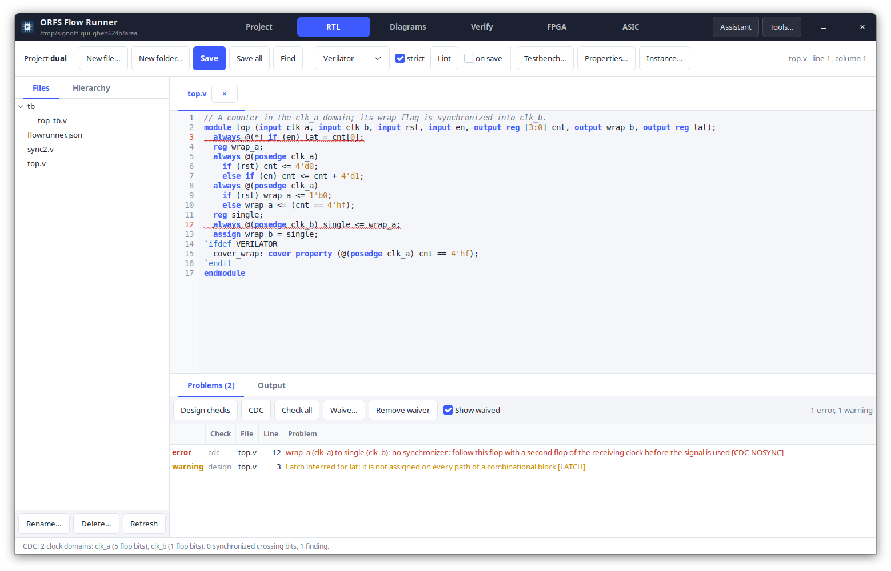
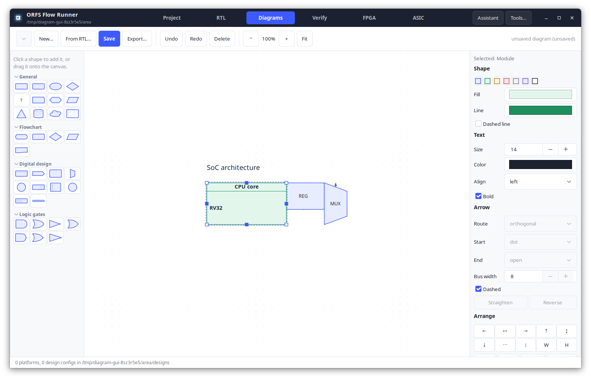
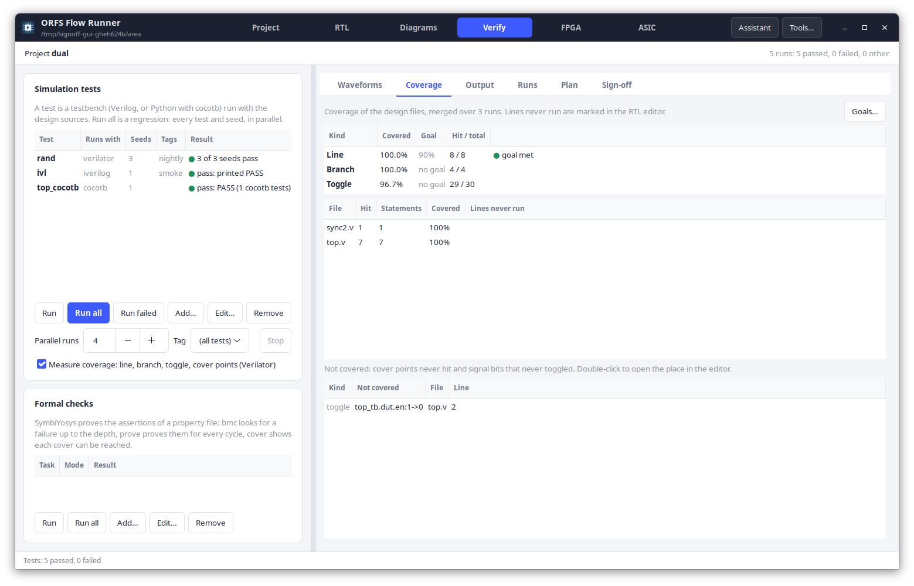
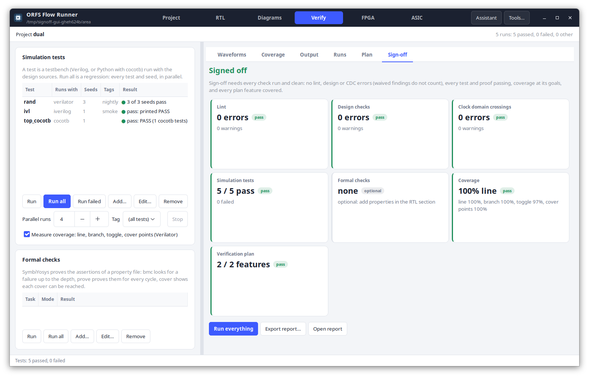
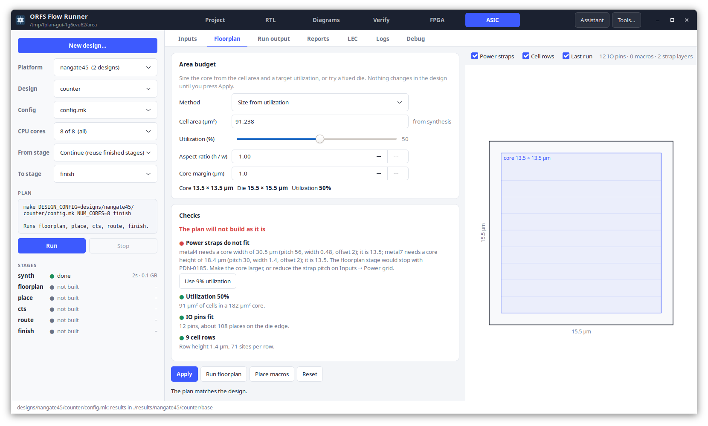
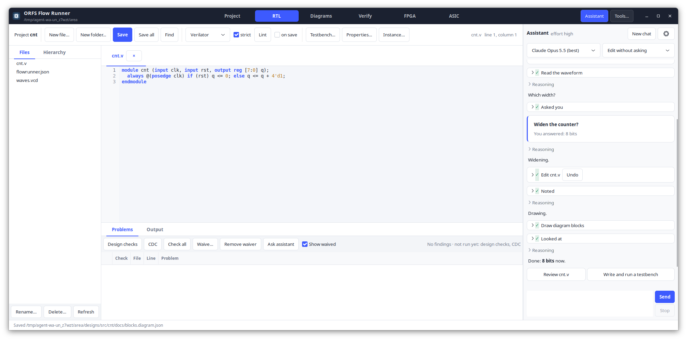
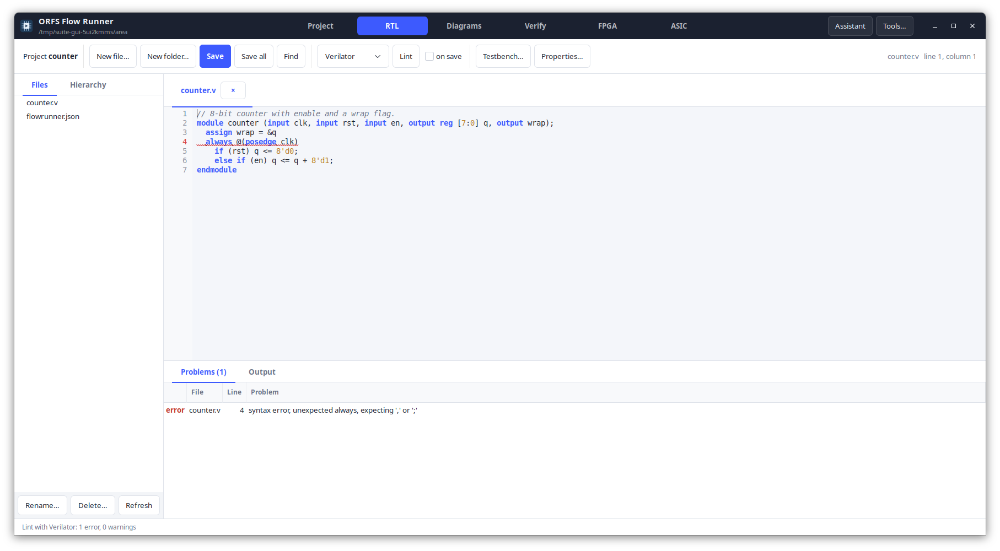
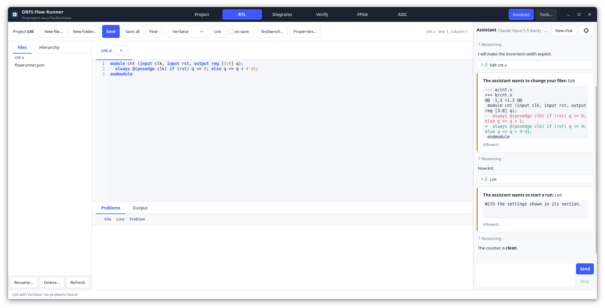

# ORFS Flow Runner as an EDA suite: RTL, verification, FPGA, diagrams, LEC and the assistant

ORFS Flow Runner covers the whole path from an empty folder to a chip or an FPGA bitstream. The header bar
switches between six sections that share one **project** (a folder of RTL); the **Assistant** button opens an AI
design assistant beside any of them.

| Section | What you do there | Tools it runs |
| --- | --- | --- |
| **Project** | Make a work area, create, clone or import projects, pick the top module, include folders, defines; git pull and commit | git |
| **RTL** | Write Verilog/SystemVerilog in an editor with syntax colors, find, undo; lint, design checks and clock-domain-crossing analysis with waivers; generate testbenches, cocotb tests and formal wrappers | Verilator, Icarus, Yosys |
| **Diagrams** | Draw architecture diagrams like draw.io, or a block diagram from the RTL; export PNG/SVG | – |
| **Verify** | Parallel regressions with seeds and tags, coverage against goals, waveforms, formal checks, a verification plan, and a sign-off gate with reports | Icarus, Verilator, cocotb, SymbiYosys, GTKWave/Surfer |
| **FPGA** | Pick a board, assign pins, build, read Fmax and utilization, program the board | Yosys, nextpnr, icepack/ecppack/gowin_pack, openFPGALoader |
| **ASIC** | The OpenROAD flow from RTL to GDS with every input in pages (see [ORFS_flow_guide.md](ORFS_flow_guide.md)), and **LEC** | Yosys, OpenROAD, KLayout |

Everything is done in the app: no terminal is needed for any step below.

Contents: [Install the tools](#install-the-rtl-and-fpga-tools) · [Project](#project) · [RTL](#rtl) ·
[Diagrams](#diagrams) · [Verify](#verify) · [Sign-off](#sign-off) · [FPGA](#fpga) · [ASIC and LEC](#asic-and-lec) ·
[Assistant](#the-assistant) · [Walkthrough](#walkthrough-a-counter-from-an-empty-folder-to-gds-and-an-fpga) ·
[Files](#where-things-are-saved) · [Testing](#testing)

## Install the RTL and FPGA tools

Click **Tools…** in the header, tab **RTL and FPGA**. The tab lists each tool, whether it was found, and lets
you pick a different program. **Install OSS CAD Suite…** downloads the YosysHQ OSS CAD Suite (about 700 MB,
2 GB on disk) into `~/.local/share/orfs-flow-runner/oss-cad-suite`; no admin rights are needed. Tools are taken
from the suite first, then from `PATH`. Tested with suite build 2026-11-14 (Icarus 14, Verilator 5.055,
Yosys 0.71, nextpnr, SymbiYosys).

The ASIC flow keeps using the OpenROAD and Yosys chosen on the **ASIC flow** tab, so a suite install never
changes an ASIC result.

## Project

A **work area** is a folder for your own designs, with the ORFS `Makefile`, `scripts`, `platforms` and `util`
linked in from the flow folder, so it takes almost no space. **New work area…** makes one; **Open…** opens one.
Each **project** is a folder `designs/src/<name>/` in it, with its settings in `flowrunner.json`.

- **New project…** makes the folder with a starter module.
- **Clone repository…** runs `git clone` (URL, optional branch, shallow by default) into a new project. A failed
  clone removes the partial folder.
- **Import folder…** copies an existing folder of RTL.
- **Top module**, **Include folders** and **Defines** apply to every tool: lint, simulation, formal, FPGA and the
  ASIC design made from the project.
- The **Files** table says what each file is for: *Design* (synthesized), *Testbench* (simulation only) or
  *Not used*. The app guesses from folder names (`tb/`, `sim/`, `verif/`) and module contents.
- **Create ASIC design…** makes an ORFS design (`designs/<platform>/<name>/config.mk` with an SDC) that points at
  the project's files, so RTL edits reach the next ASIC run without copying.
- **Filelist…** exports the project's compile order as a `.f` file (`+incdir+`, `+define+`, then the files), the
  form simulators, linters and synthesis tools all read, or imports one: nested `-f` files, `$VAR` paths and
  comments are handled. Files outside the project folder are listed, not used.
- **Pull** and **Commit…** run git; Commit initialises a repository first if there is none.

## RTL

The left side has the project's **Files** and the module **Hierarchy** under the top. Double-click to open.

- The editor has line numbers, Verilog/SystemVerilog/Tcl/Make colors, auto-indent, **Ctrl+F** find,
  **Ctrl+/** comment, **Ctrl+Z / Ctrl+Shift+Z**, and **Ctrl+S** save. **New file…** offers templates (empty
  module, counter, state machine, synchronous FIFO).
- **F12** goes to the definition of the name under the cursor: a module opens in its file, a signal goes to its
  declaration. **Instance…** inserts an instance of a module at the cursor with every port connected by name.
- **Testbench…** writes a testbench for a module and adds it to the tests. *Verilog*: `tb/<module>_tb.v` with a
  clock, a reset of the right polarity, a waveform dump, a seed (`+seed=<n>`), a timeout and a PASS/FAIL line.
  *cocotb*: `tests/test_<module>.py`, where Python coroutines drive the module.
- **Properties…** writes `formal/<module>_formal.sv`, a wrapper that instantiates the module with starter
  assumptions and assertions, and adds a formal task.

### RTL checks

Three checks put their findings in one **Problems** list, each with the check that found it, its file and line.
Findings are underlined in the editor; double-click one to go there.

| Check | Finds | How |
| --- | --- | --- |
| **Lint** | syntax and elaboration errors, width mismatches, unused and undriven signals, style | Verilator, Icarus or Yosys, or **All linters** (their reports are merged; one finding per line and code). **strict** adds the style and width warnings (`-Wall`); without it only likely bugs are reported. **on save** lints on every save. |
| **Design checks** | inferred latches, combinational loops, nets with several drivers, nets used without a driver | Yosys elaborates the design (`proc`, `check`) |
| **CDC** | signals crossing between clock domains unsafely | a structural analysis of the flattened netlist, below |

**Clock domain crossings.** Every flip-flop belongs to the domain of the net on its clock pin (followed back
through buffers and inverters). A crossing is a flop whose data input is reached from a flop of another domain:

| Result | Meaning | Fix |
| --- | --- | --- |
| *synchronized* (not a finding) | the data comes straight from one flop of the other domain into a flop that is followed by a second flop of the receiving clock: a two-flop synchronizer | – |
| `CDC-NOSYNC` (error) | the data comes straight across, but no second flop follows | add the second flop before the signal is used |
| `CDC-LOGIC` (error) | combinational logic sits between the domains, so a glitch can be captured | register the signal in the sending domain, then synchronize it |
| `CDC-BUS` (warning) | several bits of one register each go through their own synchronizer and can arrive in different cycles | gray code, a handshake or an asynchronous FIFO |

The Output tab lists the domains with their flop counts and every crossing. Not covered: crossings through
memories and latches, reset-domain crossings, and inputs of the top module (their domain is not in the RTL). As
with any structural CDC tool, a clean report is evidence, not proof.

**Waivers.** Select a finding and press **Waive…** to accept it on purpose, with a reason. A waived finding
stays in the list (greyed, with its reason) and in the sign-off report, but no longer counts. Waivers are saved in
the project's `flowrunner.json` and match by check, code, file and message, not by line number, so they survive
edits elsewhere in the file. **Remove waiver** makes the finding count again.



## Diagrams

A diagram editor in the style of draw.io. Diagrams are saved as `docs/*.diagram.json` in the project and drawn
the same on screen and in every export.

**Shapes.** The palette on the left has 34 shapes in four groups. Click one to add it in the middle of the view,
or drag it onto the canvas.

| Group | Shapes |
| --- | --- |
| General | rectangle, rounded, ellipse, diamond, text, note, hexagon, parallelogram, triangle, cylinder, cloud, container |
| Flowchart | start / end, process, decision, data, document |
| Digital design | module, port, register, mux, adder, FIFO, memory, FSM state, clock, bus |
| Logic gates | AND, OR, NOT, XOR, NAND, NOR, buffer |

**On the canvas.**
- Click selects, **Shift+click** adds, dragging on empty space draws a selection box. Clicking one shape of a
  group selects the group.
- Drag to move. Moves snap to the grid and to the edges and centers of other shapes; a pink guide line shows the
  match. Arrow keys nudge by the grid (Shift: by one unit).
- A selected shape has eight resize handles.
- Hovering a shape shows four blue connection points: drag from one onto another shape to draw an arrow. A
  selected arrow shows the middle of each segment: drag one to add a waypoint and route the arrow your way; drag
  a waypoint back onto the line to remove it.
- Double-click (or **F2**) edits a label in place; **Enter** finishes, **Shift+Enter** adds a line, **Escape**
  cancels.
- The wheel scrolls, **Ctrl+wheel** zooms about the pointer, middle-drag or **Space+drag** pans, **Fit** shows it
  all. Right-click opens the menu of the commands below.

**Format panel** (right), for what is selected:
- Shape: color presets, fill and line colors, dashed line; text size, color, alignment and bold.
- Arrow: route (orthogonal, straight or curved), start and end heads (arrow, open, diamond, dot, none), bus width,
  dashed; **Straighten** removes waypoints, **Reverse** swaps the ends.
- Arrange: align left, center, right, top, middle, bottom; space evenly across or down; same width or height;
  bring to front, send to back; group and ungroup.
- Diagram: title, grid and snapping.

**Keys.** Delete; Ctrl+Z / Ctrl+Y undo and redo (200 steps); Ctrl+A, Ctrl+C, Ctrl+X, Ctrl+V; Ctrl+D duplicate;
Ctrl+G / Ctrl+Shift+G group and ungroup; Ctrl+S save.

**From RTL…** draws a module's block diagram: its ports, its submodule instances and the nets between them
(through `assign` aliases too). Edit the result freely. **Export…** writes PNG, SVG, PDF, or a `.drawio` file to
keep editing in draw.io (diagrams.net).



## Verify

**Tests.** A test is a testbench top with how it runs: Icarus, Verilator, or **cocotb** (Python coroutines
driving the design's top through Icarus). Each test can also have:

| Setting | Meaning |
| --- | --- |
| Seeds | how many seeds to run it with. Each seed is its own run, named `<test>.s<seed>`, and gets `+seed=<n>` (read it with `$value$plusargs("seed=%d", seed)`). |
| First seed | the first seed number, or `random` for new seeds every regression |
| Timeout | seconds before a run is stopped and marked *timeout* (default 600) |
| Tags | words such as `smoke` or `nightly`; the **Tag** menu makes **Run all** run only tests with that tag |
| Run arguments | plusargs passed to the simulation |

**Regressions.** **Run all** builds each test once and runs every seed, **Parallel runs** at a time, each run in
its own folder so waveforms, logs and coverage never mix. **Run** runs the selected test, **Run failed** only
the tests that did not pass, **Stop** ends the regression. The **Runs** tab lists every run with its seed,
verdict, time and reason; double-click a run for its waveform, or **Show log** for its output. A run **passes**
when it prints `PASS` and exits cleanly, **fails** on a non-zero exit, `FAIL`, `ERROR`, `$error`, `$fatal` or a
failed assertion, and otherwise shows **ran**. Verilator runs check SystemVerilog assertions (`--assert`). The last
regressions are listed under the table, and results are kept in `build/<project>/verify_results.json`.

**Coverage.** Tick *Measure coverage* (Verilator tests). Coverage of all runs is merged, and only the design
files count: a testbench covering itself proves nothing.

| Kind | Measures |
| --- | --- |
| Line | statements of always blocks that ran |
| Branch | both arms of each `if` and `case` |
| Toggle | each bit of each signal seen going 0→1 and 1→0 |
| Cover points | SystemVerilog `cover property` statements (functional coverage): how often each was hit |

**Goals…** sets the percentage each kind must reach for sign-off (0: measured, not required). The Coverage tab
shows each kind against its goal, the lines never run per file, and the cover points never hit and bits that
never toggled; double-click to open the place. In the RTL editor, lines no test ran are tinted.



**Waveforms.** The wave viewer opens the test's VCD at the first edges of its busiest clock. Search signals,
add them with a double-click, **Ctrl+wheel** to zoom, **Shift+wheel** to pan, click to place the cursor, and pick
the radix (hex, decimal, binary). **Open in GTKWave** or **Surfer** hands the same file to those viewers. After a
regression the viewer shows a failing run first, since that is the one to debug.

**Formal.** Each formal task has a top, a mode and a depth: *bmc* looks for a failing trace up to the depth,
*prove* proves the assertions by induction, *cover* looks for traces that reach each `cover`. SymbiYosys runs it;
a failure shows the failed assertions and opens the counterexample trace in the wave viewer. **Run all** runs
every task.

**Verification plan.** The **Plan** tab lists the features the design must be shown to have, and for each the
tests, formal tasks and cover points that show it. A feature is *covered* when every linked test passes on all
its seeds, every linked proof passes and every linked cover point was hit; otherwise it shows what is missing.

## Sign-off

The **Sign-off** tab of Verify gives one verdict for the project:

| Item | Passes when |
| --- | --- |
| Lint, Design checks, Clock domain crossings | the check was run and no errors are left (waived findings do not count; warnings are shown, not gating) |
| Simulation tests | every run passed |
| Formal checks | every task passed (optional when the project has none) |
| Coverage | each kind with a goal reaches it |
| Verification plan | every feature is covered (optional when there is no plan) |

A check that was never run shows *not run* and does not pass: unverified is not verified. **Run everything** runs
lint, the design checks, CDC, the regression with coverage and every formal task, in order. **Export report…**
writes into `build/<project>/reports/`:

- `signoff.html`: the verdict, every item, the plan, each run, coverage, every finding with its waiver reason,
  and the regression history. Self-contained, for a review or a release record.
- `junit.xml`: the runs and proofs as JUnit XML, which CI systems read.
- `findings.json`: the items and findings for scripts.



## FPGA

Pick a **board** (iCEBreaker, iCEstick, ULX3S 85F, OrangeCrab 25F, Tang Nano 9K, Tang Nano 20K) or *Custom* and
set family, device, package, target MHz and IO standard. The **Pins** table lists every bit of the top's ports;
**Suggest pins** puts the clock on the board's oscillator, outputs on LEDs and inputs on buttons. The pin file
(`.pcf`, `.lpf` or `.cst`) is written from the table, so it is never edited by hand.

**Build** runs Yosys (`synth_ice40` / `synth_ecp5` / `synth_gowin`), nextpnr and the packer. The results show
each clock's Fmax against the target (*met* / *not met*) and the use of LUTs, flip-flops, IO, RAM and DSPs.
**Program (SRAM)** loads the bitstream with openFPGALoader until power-off; **Program flash** writes it
permanently, after asking.

## ASIC and LEC

The ASIC section is the ORFS flow described in [ORFS_flow_guide.md](ORFS_flow_guide.md): the side panel picks the
design and stages, the Inputs tab sets every input (SDC, floorplan, IO pins, power grid, placement, clock tree,
routing), and Reports shows the sign-off checks.

### Floorplan planner

The **Floorplan** tab, next to Inputs, plans the chip's floorplan before anything runs. The settings are a
what-if until **Apply** writes them into the design (through Inputs → Floorplan, so the two always agree).

- **Area budget**: the cell area (from synthesis once it has run; type an estimate before), then either a target
  utilization with an aspect ratio and a core margin, or a fixed die. The core and die it gives, and the
  resulting utilization, update as you type.
- **Checks**, each with a plain reason and, where a number fixes it, a button that applies the fix:

| Check | Fails when | Fix offered |
| --- | --- | --- |
| Utilization | the cells do not fit, or it is above 80% (warning) or below 10% (warning) | 60 to 65%, or a die grown for 60% |
| Power straps | a strap layer of the power grid script needs more core than there is: the cause of OpenROAD's `PDN-0185` | the highest utilization, or the die size, at which they fit |
| IO pins | the die edge has fewer places on the pin layers than the top module has pin bits | – |
| Cell rows | the core has fewer than four rows | – |
| Aspect ratio | the core is more than three times longer one way | – |
| Macros | a macro is outside the core, overlaps another (with the channel), or macros take most of the core | – |

- **The drawing**, to scale: die, core, cell rows, the power straps (drawn only where they fit), macros with
  their channels, and the last floorplan run dashed in grey. Drag a macro to move it; it snaps to the placement
  grid. **Place macros** gives a first legal placement along the core's left edge.
- **Run floorplan** applies the plan and runs the flow up to the floorplan stage; the drawing then shows the real
  die and core beside the plan.



### LEC

**LEC** (logical equivalence checking) is a tab next to Reports. It proves that the flow did not change what the
design does:

| Check | Compares | Needs |
| --- | --- | --- |
| RTL vs synthesis | the project's RTL and `1_2_yosys.v` | synthesis |
| Synthesis vs final | `1_2_yosys.v` and `6_final.v` (after buffering, resizing, CTS and fill) | finish |
| Synthesis vs a stage | `1_2_yosys.v` and a netlist written from that stage's database (floorplan, place, cts, route) | that stage |

Each check runs Yosys's equivalence flow (`equiv_make`, `equiv_simple -seq 5`, `equiv_induct -seq 5`) with the
platform's Liberty cells. *Equivalent* means every output and flip-flop of both sides was proven equal;
*not proven* lists the points that differ. Scripts, logs and results are in `<results>/lec/`. ORFS's own
`LEC_CHECK` needs the kepler-formal tool, which is not public, so the app uses Yosys instead.

## The assistant

Click **Assistant** in the header (or **Ctrl+Shift+A**). The panel stays beside whatever section is open, so you
can watch it work in the editor, the wave viewer or the flow.

**Setup** (once):
1. **Install Claude SDK** in the panel puts the Anthropic Python SDK into
   `~/.local/share/orfs-flow-runner/pylib` with `uv` or `pip`; no admin rights are needed.
2. Give it a Claude API key with the gear button (kept in `~/.config/orfs-flow-runner/assistant_key`, readable
   only by you), or set `ANTHROPIC_API_KEY`, or sign in with `ant auth login`.

**Using it.**
- Type and press **Enter** (**Shift+Enter** for a new line). Above the box, **suggestions** follow the project's
  state: *Fix 2 CDC errors*, *Debug fifo_tb.s3*, *Raise line coverage from 82% to 90%*, *Fix the floorplan plan*,
  *Why did the ASIC run fail?*; click one to send it.
- **Ask assistant** buttons send a question about what you are looking at: on a finding in RTL → Problems, and on
  a run in Verify → Runs.
- Under the header, pick the **model** (Claude Opus 5.5 by default; Sonnet 5.5 is faster, Haiku 5.5 the cheapest)
  and **how much it may do without asking**: *Ask before edits and runs*, *Edit without asking*, or *Edit and run
  without asking*. Reads never ask. The gear sets the effort (how long it thinks; *high* by default) and the key.
- The line under the chat shows the tokens the chat has used and a rough cost at list price.

**What it knows.** A new chat starts with the project overview and the project's notes. Each message carries
what you are looking at: the section, the project, the file and line in the editor, any text you selected there,
and the ASIC design.

**What it can do.**

| Kind | Tools |
| --- | --- |
| Read (runs at once) | project overview, list, read and search files, module hierarchy; findings of lint, design checks and CDC with waivers; every crossing; regression runs; coverage against goals; the plan's status; the sign-off gate; **signal values from a waveform** around a failure; **the floorplan plan and its checks**; **the diagram** as data; **a picture** of the diagram or the floorplan, to judge the layout as you see it; formal, LEC, FPGA and the ASIC metrics |
| Plan and ask | **a checklist** of its plan for longer tasks, kept current in the chat; **a question** with option buttons when a choice is yours; **notes** about the project, kept for later chats |
| Edit | edit or write a file (RTL, testbench, SDC, `config.mk`, docs), change project settings (tests with seeds and tags, formal tasks, the verification plan, coverage goals, waivers, FPGA target and pins), create a project, generate a testbench or formal wrapper, draw or redraw a diagram with any shape and arrow style, **change and apply the floorplan plan** |
| Run | lint, design checks and CDC, tests in parallel with coverage, formal, the whole sign-off run, LEC, FPGA build, ASIC flow from one stage to another |

When it asks, the panel shows the diff before an edit and what it will start before a run. **Allow** runs it
once, **Allow for this chat** stops asking for that kind until **New chat**, **Deny** refuses it (the assistant is
told not to retry). Every file edit has an **Undo** button in the chat that puts the file back as it was. **Stop**
ends the turn after the current step. Writes are limited to the project folder and the selected ASIC design's
folder; reads to the work area and the ORFS flow. A file with unsaved edits in the editor is never overwritten.

Things to ask: *"Review my RTL for bugs and lint it"*, *"Write a testbench for the FIFO that checks full and
empty, and run it"*, *"fifo_tb fails: find out why from the waveform and fix it"*, *"Run sign-off and fix what
fails"*, *"Coverage is at 82%: add tests for the lines never run"*, *"Draw the architecture of the SoC, with the
bus widths"*, *"Plan the floorplan for 60% utilization and place the RAMs"*, *"The route stage fails timing:
find out why and fix the SDC"*.

Every message is sent to the Claude API and billed to the key's account. The panel shows each tool call and its
result, so you can see what was read and changed.



## Walkthrough: a counter from an empty folder to GDS and an FPGA

This is what `gui/tests/test_gui_suite.py` does with the app's own buttons.

1. **Project → New work area…**, then **New project…** named `counter`.
2. **RTL**: write the counter, **Lint** (clean). A missing `;` shows as an error on its line.
3. **Testbench…** for `counter`; edit it to check the count; **Verify → Run all** with Icarus and Verilator, with
   coverage ticked. Both pass; the wave viewer shows `clk`, `q` and `wrap`.
4. Add a formal task in *prove* mode: proven.
5. **Diagrams → From RTL…**: the block diagram.
6. **Project → Create ASIC design…** on nangate45 with a 5 ns clock; **ASIC**: *Continue* to *finish*, **Run**.
   Reports shows the checks and the GDS; **LEC → Run all**: both checks *equivalent*.
7. **Project → Clone repository…** a blinky repo; **FPGA**: iCEBreaker, ULX3S and Tang Nano 9K, **Suggest
   pins**, **Build**: timing met on all three.






## Where things are saved

| Path | What |
| --- | --- |
| `<work area>/designs/src/<project>/` | the project's RTL, `tb/`, `formal/`, `docs/*.diagram.json` and `flowrunner.json` |
| `<work area>/build/<project>/sim/<test>/` | the test's build, and its run's log, VCD and coverage; each seed in a subfolder `s<seed>/` |
| `<work area>/build/<project>/checks/` | the design-check script and log, the flattened netlist CDC reads, and `findings.json` |
| `<work area>/build/<project>/reports/` | `signoff.html`, `junit.xml`, `findings.json` |
| `<work area>/build/<project>/regressions.json` | the history of the last 50 regressions |
| `<work area>/build/<project>/formal/<task>/` | the `.sby` file and SymbiYosys's work folder with traces |
| `<work area>/build/<project>/fpga/` | Yosys JSON, constraint file, nextpnr report and the bitstream |
| `<work area>/build/<project>/verify_results.json` | the last test, formal and coverage results |
| `<results>/lec/` | LEC scripts, logs and `lec_results.json` |
| `~/.local/share/orfs-flow-runner/oss-cad-suite/` | OSS CAD Suite installed from Tools… |
| `~/.local/share/orfs-flow-runner/pylib/` | the Claude SDK installed from the assistant |
| `~/.config/orfs-flow-runner/assistant_key` | the API key typed in the assistant's settings (mode 600) |

## Testing

```bash
python3 -m unittest discover -s gui/tests -p 'test_suite_units.py' -v
```
The RTL parser, work areas, projects and filelists, lint parsing, waivers, coverage merging and goals, seeds and
tags, the sign-off gate and its reports, simulation/formal/LEC verdicts, the VCD reader, FPGA pins and constraint
files, diagrams, the assistant's tools and input checks; and, when OSS CAD Suite is installed, real runs: Icarus,
Verilator, lint, SymbiYosys (a proof and a failing check), LEC (a proven and a broken netlist), the design checks
and every CDC class on a design with one of each problem, and a parallel regression with seeds, a timeout,
coverage and cocotb. About 30 seconds.

```bash
gui/tests/run_gui_tests.sh gui/tests/test_gui_diagram.py
```
The diagram editor through its mouse and key handlers: selection (click, Shift+click, box), moving with snapping
to the grid and to other shapes, resizing, drawing an arrow from a connection point, waypoints, in-place label
editing, styles, copy/paste/duplicate, align and distribute, groups, stacking, undo/redo, zoom and fit, save and
reload, the four export formats, and a block diagram from RTL. Under a minute.

```bash
gui/tests/run_gui_tests.sh gui/tests/test_gui_floorplan.py
```
The Floorplan planner on a tiny counter (the power straps do not fit at 50%; the offered fix is applied and the
real floorplan stage then passes at the planned size) and on a design with two RAM macros (legal placement, an
overlap found after a drag, the macro file written). About two minutes.

```bash
gui/tests/run_gui_tests.sh gui/tests/test_gui_signoff.py
```
RTL sign-off through the GUI on a two-clock design: the checks on clean RTL, a planted latch and a planted
unsynchronized crossing found on their lines, a waiver, a regression with seeds on Verilator, Icarus and cocotb,
merged coverage against goals, the plan, *Run everything* reaching *Signed off*, the HTML and JUnit reports,
filelists, F12, and the assistant's view. About two minutes.

```bash
gui/tests/run_gui_tests.sh gui/tests/test_gui_agent.py
```
The assistant panel against a scripted stand-in for the Claude API: reads, an approved edit landing on disk,
a denied write that does not, lint run through the assistant, bad tool input, a path outside the project, the
plan checklist, a question answered with a button, waveform values, a picture of a diagram, notes, Undo, the
approval modes, suggestions from the project's state, and Ask assistant on a finding. No key or network needed.

```bash
gui/tests/run_gui_tests.sh gui/tests/test_gui_suite.py
```
The walkthrough above on three designs (counter, a cloned blinky, a FIFO from the template), through the GUI,
including the ASIC run to GDS and LEC. About ten minutes.
