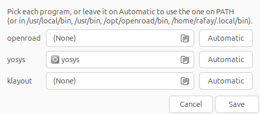
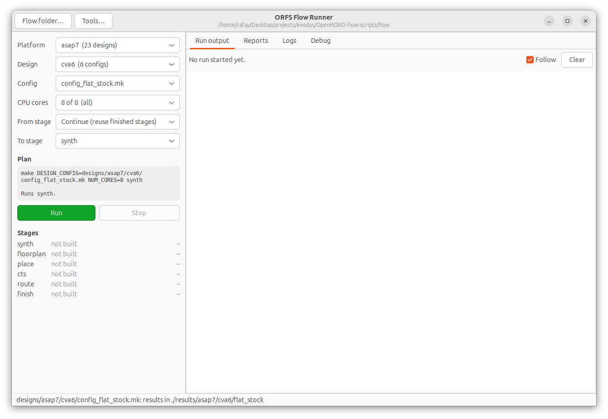
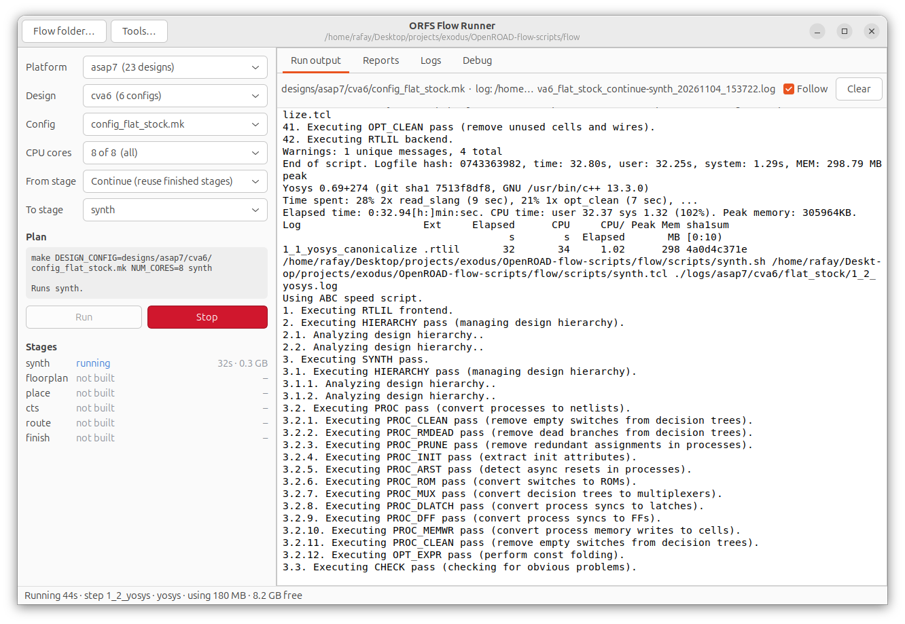
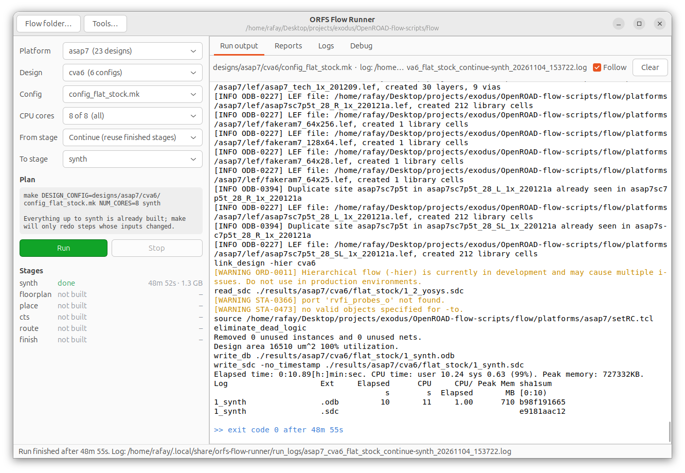
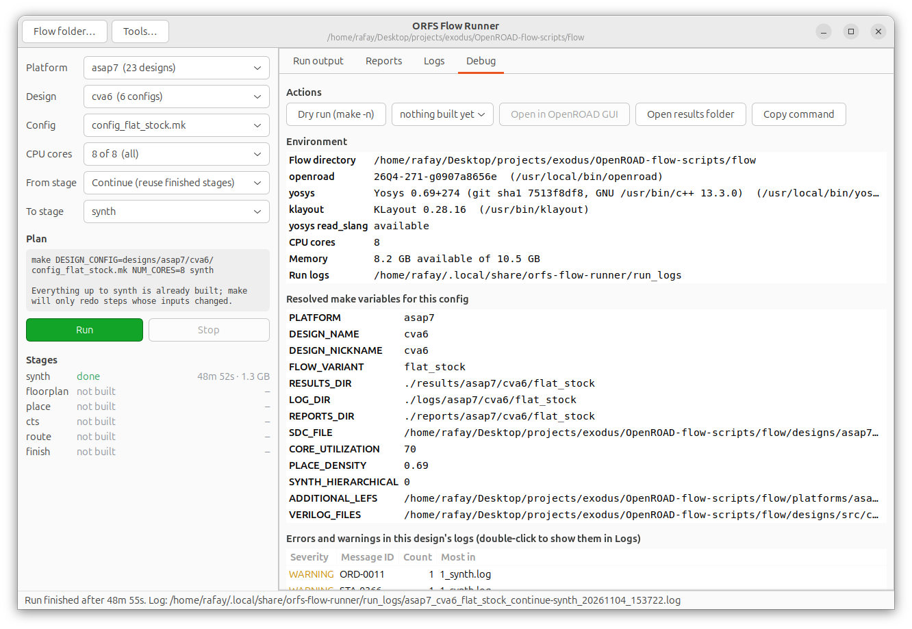
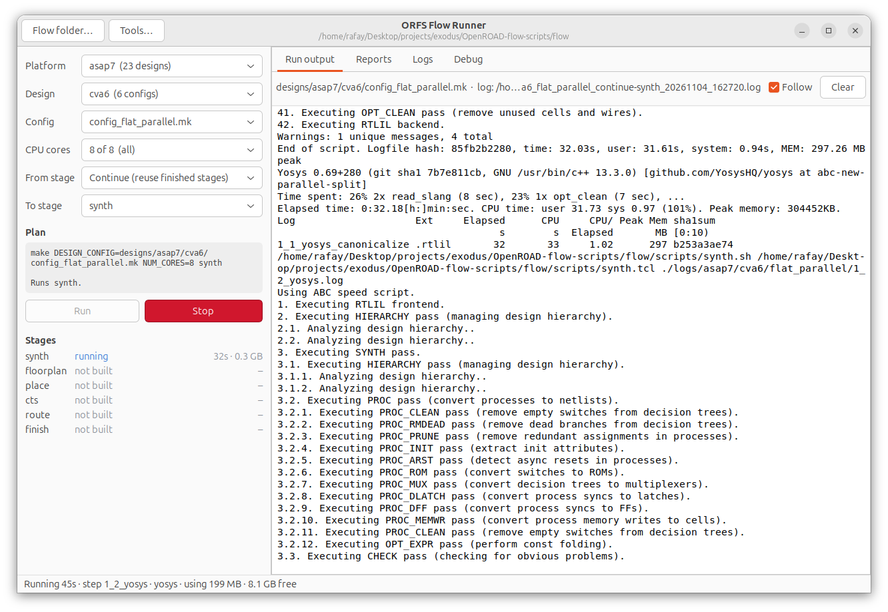
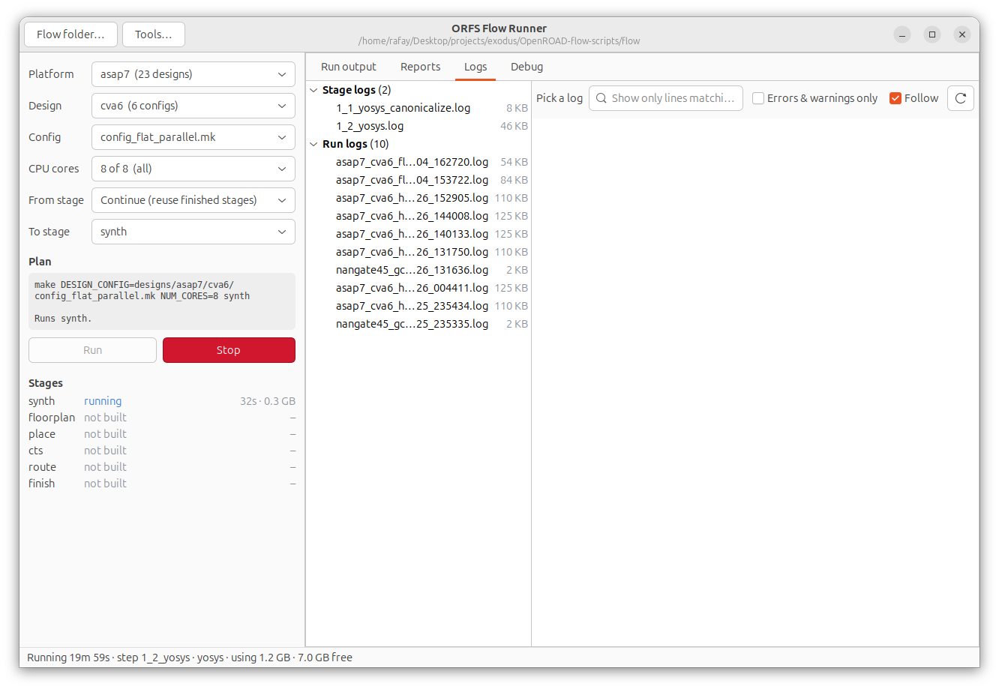
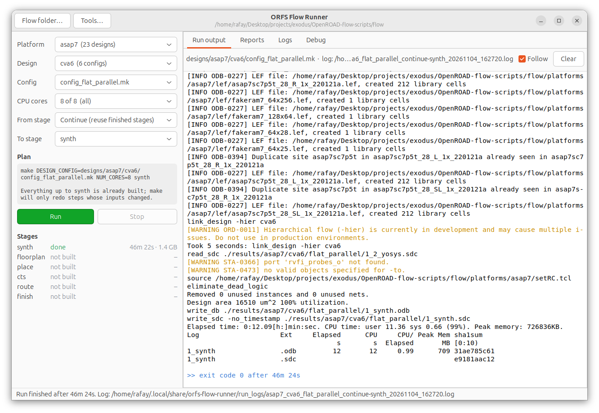
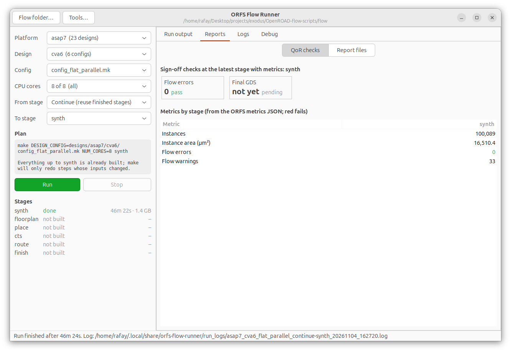
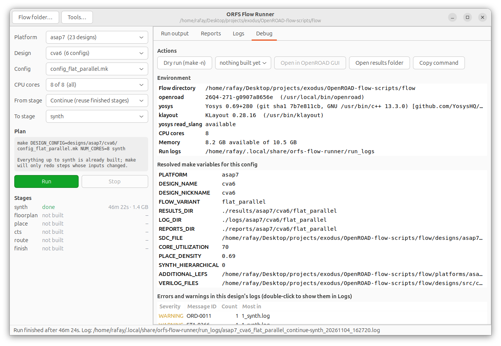

# CVA6 flat synthesis: stock vs parallel `abc_new`

CVA6 (asap7) synthesized flat (`SYNTH_HIERARCHICAL = 0`) from scratch with two Yosys builds, driven
through the ORFS Flow Runner GUI. All runs were on 4–5 Nov 2026, on the same 8-core, 10.5 GB VirtualBox VM.

| Side | Yosys | Config |
| --- | --- | --- |
| Stock | `0.69+274` (`7513f8df8`), `/usr/local/bin/yosys` | `designs/asap7/cva6/config_flat_stock.mk` |
| Parallel | `0.69+280` (`7b7e811cb`, branch `abc-new-parallel-split`), `yosys/build/yosys` | `designs/asap7/cva6/config_flat_parallel.mk` |

Both configs include `config_hier.mk` and change only `SYNTH_HIERARCHICAL` (to 0) and `FLOW_VARIANT`. They
keep the same relaxed `constraint_hier.sdc` (5000 ps, 200 MHz), `SWAP_ARITH_OPERATORS = 1` and the slang
frontend, so these numbers can be set directly against the hierarchical A/B from 26 Oct. Yosys and ABC don't
read the SDC in this flow (ABC gets only `abc.constr`: driver cell and load), so a 1 GHz SDC would give the
same netlist; the clock matters from `1_synth` in OpenROAD onward.

The configs are in `orfs/flow/designs/asap7/cva6/` in this repo. The nangate45 counterpart of this report is
[../nangate45/cva6_nangate45_flat.md](../nangate45/cva6_nangate45_flat.md).

## Results

| Run | Side | Wall (s) | Yosys (s) | `abc_new` (s) | Peak mem (MB) | Area (µm²) | Cells | VM time lost | Timing used |
| --- | --- | ---: | ---: | ---: | ---: | ---: | ---: | --- | --- |
| 1 | stock | 2936 | 2888 | 1840 | 1371 | 16350.69 | 100,089 | ~115 s | yes |
| 2 | parallel | 2789 | 2737 | 1709 | 1466 | 16350.69 | 100,089 | none | yes |
| 3 | parallel | 60712 | — | — | 1451 | 16350.69 | 100,089 | VM paused overnight | **no** |
| 4 | stock | 4025 | 3968 | 2965 | 1377 | 16350.69 | 100,089 | ≥61 s RCU stall | **no** |
| 5 | parallel | 3078 | 3004 | 1875 | 1444 | 16350.69 | 100,089 | ≥61 s RCU stall | yes, with care |
| 6 | stock | 3770 | 3706 | 2421 | 1358 | 16350.69 | 100,089 | none logged | yes |

"VM time lost" is what the guest kernel logged: clocksource watchdog gaps, RCU stalls and clock jumps. It
undercounts host-side slowdowns. Run 3 ran while the laptop was closed. Run 4 had an RCU stall, and its
`abc_new` took 1125 s longer than run 1's on the same binary and input.

**Quality of results: identical.** All six netlists are byte-identical (`1_2_yosys.v` body sha1
`69023b3b3af7…`), with the same area and cell count. Runs 2 and 3 fed ABC a slightly different
pseudo-output order for a few buffer cells (`$auto$rtlil_bufnorm` IDs), but the mapped netlist came out the same.

**Runtime: small gain, smaller than the noise.** In every usable pair the parallel build finished sooner:

| Pair (adjacent in time) | Stock wall | Parallel wall | Difference | Stock `abc_new` | Parallel `abc_new` |
| --- | ---: | ---: | ---: | ---: | ---: |
| runs 1 / 2 | 2936 s | 2789 s | −147 s (−5.0 %) | 1840 s | 1709 s (−7.1 %) |
| runs 5 / 6 | 3770 s | 3078 s | −692 s (−18 %) | 2421 s | 1875 s (−23 %) |

The same stock binary took anywhere from 2936 s to 3770 s on this VM (+28 %). So these numbers can't pin the
speedup more tightly than "a few percent, likely around the 5–7 % of the cleanest pair". The 18 % pair
is mostly the machine. The design's structure points the same way.

## Why flat gains little

With `SWAP_ARITH_OPERATORS = 1`, `abc_new` maps 65 modules in flat mode: the flattened `cva6` plus 64 small
`ALU_*` operator wrappers (the Han-Carlson versions it uses and the unused Brent-Kung / Sklansky /
Kogge-Stone copies). `cva6` instantiates the ALUs as `abc9_box`es, so its mapping can't start until they
are done. That leaves the bulk of the work serial:

- ABC on `cva6` alone ran about 15 minutes in run 2 (`208,539` AND nodes after mapping, one `yosys-abc` process).
- Yosys' own single-threaded work around each module (`abc9_ops`, XAIGER write, `portarcs`, reintegration)
  makes up roughly the other half of `abc_new`. The patch doesn't parallelize that part.
- Only the small ALU modules can overlap. In the 5-second CPU samples, neither the stock nor the parallel
  run ever showed more than one `yosys-abc` running at once.

In the hierarchical flow, by contrast, `csr_regfile`, `multiplier`, `pmp`, `store_buffer` and other large
kept modules are independent of each other, so they really do map side by side.

## Flat vs hierarchical (same SDC and settings)

| | Flat (this report) | Hierarchical (26 Oct A/B) |
| --- | ---: | ---: |
| Area (µm²) | 16,350.69 | 21,218.85 |
| Cells | 100,089 | 141,810 |
| Stock wall (s) | 2936, 3770 | 2562, 3159 |
| Parallel wall (s) | 2789, 3078 | 2255, 2873 |
| Netlists identical stock vs parallel | yes | yes |

Flat synthesis gives 23 % less area and 29 % fewer cells, since optimization crosses module boundaries.
It runs about as long as hierarchical, and the parallel `abc_new` helps it less.

## Flow Runner screenshots

Stock run (run 1):

| | |
| --- | --- |
|  |  |
|  |  |
|  |  |

Parallel run (run 2):

| | |
| --- | --- |
|  |  |
|  |  |
|  |  |

The QoR tab's 16,510.4 µm² is OpenROAD's area after `link_design` in `1_synth`. The 16,350.69 µm² in the
tables is Yosys' `synth_stat.txt`. Both are the same for stock and parallel.

## Reproduce

```bash
cd ab_bench
./bench.sh flat                                   # A/B/B/A: runs 1-4, screenshots in bench_flat/
SPECS="parallel stock" N0=4 ./bench.sh flat       # the extra pair (runs 5-6)
python3 compare.py bench_flat                     # table, VM-stall check, writes bench_flat/summary.json
```

Logs, stats, netlist hashes and every screenshot for each run are in `ab_bench/bench_flat/run*/`. CPU
samples are in `ab_bench/bench_flat/run*_run.json`.

For a tighter runtime number, rerun on a quiet host (no VM, or a VM that isn't on a laptop that sleeps or
throttles). The effect is a few percent, and this VM's noise reaches ±28 %.
